# System Architecture & Gratyfikant Nexo Pro Sfera Integration Guide

**Solution**: HrAppka Import Pracowników (v1.0.8.20)  
**Target Framework**: `.NET 8.0` (`net8.0-windows10.0.17763.0`)  
**SDK Dependency**: InsERT Gratyfikant Nexo Pro SDK 62.0.0.9537  
**Host Application**: InsERT Gratyfikant Nexo Pro (`Gratyfikant nexo.exe`)  

---

## Table of Contents
1. [Executive Summary & Architectural Philosophy](#1-executive-summary--architectural-philosophy)
2. [Subsystem Breakdown](#2-subsystem-breakdown)
3. [Component Topology Diagrams](#3-component-topology-diagrams)
   - [3.1 Mermaid Component Diagram](#31-mermaid-component-diagram)
   - [3.2 Structured ASCII Topology Flowchart](#32-structured-ascii-topology-flowchart)
4. [InsERT Nexo Sfera Integration Model](#4-insert-nexo-sfera-integration-model)
   - [4.1 Unit of Work & Business Object Lifecycle](#41-unit-of-work--business-object-lifecycle)
   - [4.2 The Multi-Context Entity Framework Trap (`ModelDanychContainer`)](#42-the-multi-context-entity-framework-trap-modeldanychcontainer)
   - [4.3 Mox DataDomain & Child Entity Sponsorship Rules](#43-mox-datadomain--child-entity-sponsorship-rules)
5. [Concurrency, Threading & Process Model](#5-concurrency-threading--process-model)
   - [5.1 STA UI Thread vs Background Task.Run Worker](#51-sta-ui-thread-vs-background-taskrun-worker)
   - [5.2 Win32 HWND Modal Hosting Fallback](#52-win32-hwnd-modal-hosting-fallback)
   - [5.3 Asynchronous Progress Reporting & Cooperative Cancellation](#53-asynchronous-progress-reporting--cooperative-cancellation)
6. [High-Performance In-Memory Caching Architecture](#6-high-performance-in-memory-caching-architecture)
   - [6.1 N+1 Query Elimination](#61-n1-query-elimination)
   - [6.2 Database Projections without Entity Hydration](#62-database-projections-without-entity-hydration)
   - [6.3 Multi-Tier Tax Office Resolution & Master Template Auto-Creation](#63-multi-tier-tax-office-resolution--master-template-auto-creation)
   - [6.4 Automatic Department Hierarchy Provisioning](#64-automatic-department-hierarchy-provisioning)
7. [Assembly, Namespace, and SDK Platform Constraints](#7-assembly-namespace-and-sdk-platform-constraints)

---

## 1. Executive Summary & Architectural Philosophy

The **HrAppka Import Pracowników** plugin (v1.0.8.20) provides an enterprise-grade bridge between external workforce recruitment spreadsheets/exports (such as HrAppka, WorkService, or custom CSV/Excel files) and the core relational domain model of **InsERT Gratyfikant Nexo Pro**.

Running as an in-process Sfera plugin within the Gratyfikant Nexo executable, the solution adheres to five core architectural principles:

1. **Transactional Integrity**: Every employee record, civil or employment contract, and ZUS declaration operates under strict InsERT Mox Unit of Work boundaries. If validation fails on any entity, the operation rolls back cleanly without leaving orphan data in Nexo's database.
2. **Context Isolation**: Gratyfikant Nexo assigns an independent Entity Framework `ObjectContext` (`ModelDanychContainer`) to every instantiated Business Object (`IObiektBiznesowy`). The architecture resolves and attaches all foreign entities within the target Business Object's context, eliminating detached entity runtime crashes.
3. **N+1 Query Elimination**: Pre-caching static reference dictionaries (countries, citizenships, tax offices, master offices, departments, currencies, custom flags) and creating lightweight database projections for existing PESEL and Passport records reduces database roundtrips by up to 95%.
4. **Resilient Normalization**: Messy, user-generated string data (e.g. combined address fields, scientific-notation PESEL strings from Excel, mixed-case international names, Modulo 97 IBAN numbers) is sanitized, parsed via compiled regular expressions, and enriched using an offline SQLite database (`DaneAdresowe.db`).
5. **Interactive Operator Oversight**: High-performance virtualized WPF user interfaces hosted via native Win32 window handles empower human operators to review validation issues, override contract templates, re-map tax offices, and select duplicate conflict actions before committing data to the database.

---

## 2. Subsystem Breakdown

The system is structured into six decoupled subsystems:

```
+----------------------------------------------------------------------------------------------------+
|                                    Subsystem Breakdown Matrix                                      |
+-------------------+------------------------------------------+-------------------------------------+
| Subsystem         | Primary Classes                          | Architectural Responsibility        |
+-------------------+------------------------------------------+-------------------------------------+
| 1. Ingestion &    | UniversalFileLoader, Rfc4180CsvReader,   | Detects file types (.xlsx/.csv),    |
|    Normalization  | AddressNormalizer, ZusSchemaLimits,      | parses RFC 4180 streaming data,     |
|                   | AddressEnrichmentService,                | normalizes addresses via regex,     |
|                   | BankClearingResolver,                    | queries SQLite DaneAdresowe.db,     |
|                   | ZusCitizenshipManager,                   | validates IBAN checksums, and       |
|                   | DocumentIdentificationService            | maps ZUS identity documents.        |
+-------------------+------------------------------------------+-------------------------------------+
| 2. Interactive    | ImportPreviewWindow.xaml,                | High-performance DataGrid with      |
|    UI Presentation| ImportPreviewViewModel,                  | row recycling, cell validation dots |
|                   | ModalWindowHostingService,               | and borders, inline ComboBoxes, and |
|                   | RowStatusToBrushConverter,               | Win32 HWND owner attachment.        |
|                   | RelayCommand                             |                                     |
+-------------------+------------------------------------------+-------------------------------------+
| 3. In-Memory Sfera| SferaDictionaryCache                     | Pre-loads reference data on warmup; |
|    Cache Engine   |                                          | executes lightweight projections;   |
|                   |                                          | performs multi-tier tax office and  |
|                   |                                          | department hierarchy auto-creation. |
+-------------------+------------------------------------------+-------------------------------------+
| 4. Sfera Native   | OperacjaImportuPracownikow20,            | Implements OperacjaNaLiscieDanych,  |
|    Import Engine  | DostawcaPluginow, GrupaOperacji,         | coordinates row import loop,        |
|                   | Rozszerzenia (PodajBledy)                | resolves duplicates, and extracts   |
|                   |                                          | deep Mox validation error logs.     |
+-------------------+------------------------------------------+-------------------------------------+
| 5. Contract       | ContractCreationService,                 | Manages contract templates, resolves|
|    Creation       | IContractCreationService                 | BO ObjectContext, enforces Mox child|
|    Service        |                                          | sponsorship, aligns wage component  |
|                   |                                          | start dates, and handles student    |
|                   |                                          | under 26 ZUS/PIT exemptions.        |
+-------------------+------------------------------------------+-------------------------------------+
| 6. ZUS Declaration| ZusDeclarationBatchService,              | Consolidates all employee           |
|    Batching       | ZusRegistrationRequest, ZusBatchResult   | registration requests into a single |
|                   |                                          | unsubmitted draft Zgloszeniowa      |
|                   |                                          | declaration with atomic save.       |
+-------------------+------------------------------------------+-------------------------------------+
```

---

## 3. Component Topology Diagrams

### 3.1 Mermaid Component Diagram

```mermaid
graph TB
    subgraph UI_Layer ["Interactive WPF UI Layer"]
        UI_Win["ImportPreviewWindow.xaml<br/>(WPF DataGrid Virtualization)"]
        UI_VM["ImportPreviewViewModel<br/>(MVVM / Gating Rules)"]
        UI_Host["ModalWindowHostingService<br/>(Win32 HWND Fallback / STA Dispatch)"]
        UI_Conv["RowStatusToBrushConverter<br/>(Frozen SolidColorBrushes)"]
        UI_Win --- UI_VM
        UI_Win --- UI_Host
        UI_Win --- UI_Conv
    end

    subgraph Ingestion_Layer ["Ingestion & Normalization Pipeline"]
        Loader["UniversalFileLoader<br/>(Auto-detect .xlsx vs .csv)"]
        CsvReader["Rfc4180CsvReader<br/>(Streaming FSM / Codepage 1250)"]
        MiniEx["MiniExcel<br/>(Streaming XLSX Reader)"]
        AddrNorm["AddressNormalizer<br/>(5 Compiled Regexes / ZusSchemaLimits)"]
        AddrEnrich["AddressEnrichmentService<br/>(SQLite DaneAdresowe.db)"]
        BankRes["BankClearingResolver<br/>(KNR Sort Code / Modulo 97 IBAN)"]
        ZusCit["ZusCitizenshipManager<br/>(Obywatelstwa_ZUS.csv / Strict No-PL)"]
        DocId["DocumentIdentificationService<br/>(Nationality Priority / 9-Char Cut)"]
        
        Loader --> CsvReader
        Loader --> MiniEx
        Loader --> AddrNorm
        Loader --> AddrEnrich
        Loader --> BankRes
        Loader --> ZusCit
        Loader --> DocId
    end

    subgraph Sfera_Core ["Sfera Native 2.0 Import Coordinator"]
        Op20["OperacjaImportuPracownikow20<br/>(OperacjaNaLiscieDanych)"]
        PluginReg["GrupaOperacji & DostawcaPluginow<br/>(Sfera Plugin Discovery)"]
        Diag["Rozszerzenia.PodajBledy<br/>(Deep Mox DataDomain Traversal)"]
        
        PluginReg --> Op20
        Op20 --> Diag
    end

    subgraph Service_Cache ["Sfera Service Layer & Caching"]
        Cache["SferaDictionaryCache<br/>(In-Memory Dictionaries & Projections)"]
        ContractSvc["ContractCreationService<br/>(BO Context Attachment & Mox Sponsorship)"]
        ZusBatch["ZusDeclarationBatchService<br/>(Single-Save Batch ZUA/ZZA)"]
    end

    subgraph InsERT_Gratyfikant ["InsERT Gratyfikant Nexo Pro SDK 62"]
        SferaHandle["IUchwyt (Sfera Handle)"]
        PodmiotyMgr["IPodmioty (Podmiot / Osoba / Pracownik)"]
        UmowyMgr["IUmowyPracowniczeGr (UmowaPracowniczaGr)"]
        DeklZusMgr["IDeklaracjeZUS (DeklaracjaZUSBO)"]
        EF_Context["ModelDanychContainer (ObjectContext)"]
        
        SferaHandle --> PodmiotyMgr
        SferaHandle --> UmowyMgr
        SferaHandle --> DeklZusMgr
        PodmiotyMgr --- EF_Context
        UmowyMgr --- EF_Context
        DeklZusMgr --- EF_Context
    end

    %% Wiring between layers
    Op20 --> Loader
    Op20 --> UI_Host
    UI_VM --> Op20
    Op20 --> Cache
    Op20 --> ContractSvc
    Op20 --> ZusBatch
    Cache --> SferaHandle
    ContractSvc --> SferaHandle
    ZusBatch --> SferaHandle
```



### 3.2 Structured ASCII Topology Flowchart

```
+====================================================================================================+
|                              GRATYFIKANT NEXO PRO PROCESS HOST                                     |
|                                                                                                    |
|  [DostawcaPluginow] ---> [GrupaOperacji (ID: 8e2be35b-...)]                                        |
|                                |                                                                   |
|                                v                                                                   |
|                 [OperacjaImportuPracownikow20]                                                     |
|                                |                                                                   |
|         +----------------------+----------------------+                                            |
|         |                                             |                                            |
|         v (Step 1: File Ingestion)                    v (Step 2: Dictionary Warmup)                |
|  +------------------------------+             +-------------------------------+                    |
|  |     UniversalFileLoader      |             |     SferaDictionaryCache      |                    |
|  |  - .xlsx via MiniExcel       |             |  - TaxOffices, Countries      |                    |
|  |  - .csv via Rfc4180CsvReader |             |  - Anonymous Person Proj.     |                    |
|  +--------------+---------------+             |  - Department Hierarchy       |                    |
|                 |                             +---------------+---------------+                    |
|                 v                                             |                                    |
|  +------------------------------+                             |                                    |
|  | Ingestion & Normalization:   |                             |                                    |
|  |  * AddressNormalizer         |                             |                                    |
|  |  * AddressEnrichmentService  |                             |                                    |
|  |  * BankClearingResolver      |                             |                                    |
|  |  * ZusCitizenshipManager     |                             |                                    |
|  |  * DocumentIdService         |                             |                                    |
|  +--------------+---------------+                             |                                    |
|                 |                                             |                                    |
|                 +----------------------+----------------------+                                    |
|                                        |                                                           |
|                                        v (Step 3: Pre-Analysis & Duplicate Matching)               |
|                         [PreAnalyzeRows(rows, cache)]                                              |
|                                        |                                                           |
|                                        v (Step 4: Interactive Operator Gating)                     |
|  +-----------------------------------------------------------------------------------------------+ |
|  |                       STA THREAD: ModalWindowHostingService.ShowModal()                       | |
|  |                                                                                               | |
|  |   [ImportPreviewWindow.xaml] <===========> [ImportPreviewViewModel]                          | |
|  |   - Virtualized DataGrid (Item Recycling)  - Validation Gating (Template/Dział required)      | |
|  |   - Inline ComboBoxes (Template, Dział)    - Background Task.Run & CancellationTokenSource    | |
|  |   - Duplicate Resolution Dropdown          - IProgress<ImportProgressReport> Realtime Events  | |
|  +-----------------------------------------------------------------------------------------------+ |
|                                        |                                                           |
|                                        v (Step 5: Background Import Execution)                     |
|                         [Task.Run: ZaimportujRow20 Loop]                                           |
|                                        |                                                           |
|                 +----------------------+----------------------+                                    |
|                 |                                             |                                    |
|                 v (Step 5a: Save Employee)                    v (Step 5b: Create Contract)         |
|  +------------------------------+             +-------------------------------+                    |
|  |   IPodmioty / IPodmiot       |             |    ContractCreationService    |                    |
|  |  - UtworzPracownika()        |             |  - Re-query via BO Context    |                    |
|  |  - Assign Address, Bank, NFZ |             |  - Mox Stanowisko Sponsorship |                    |
|  |  - Bank Collision Fallback   |             |  - Student < 26 Tax Rules     |                    |
|  |  - AutoSymbol(), Zapisz()    |             |  - 1st-of-Month Wage Start    |                    |
|  +--------------+---------------+             +---------------+---------------+                    |
|                 |                                             |                                    |
|                 +----------------------+----------------------+                                    |
|                                        |                                                           |
|                                        v (Step 6: Single-Save ZUS Batch)                           |
|                         [ZusDeclarationBatchService]                                               |
|                         - Reuse Unsubmitted Draft Declaration                                      |
|                         - Batch Add DaneZUA / DaneZZA                                              |
|                         - Single deklBO.Zapisz() Database Commit                                   |
|                                        |                                                           |
|                                        v                                                           |
|                         [PokazPodsumowanieImportu] (Summary Dialog)                                |
+====================================================================================================+
```

---

## 4. InsERT Nexo Sfera Integration Model

### 4.1 Unit of Work & Business Object Lifecycle

InsERT Gratyfikant Nexo Pro relies on the **InsERT Mox** framework (`InsERT.Mox.Core.dll` and `InsERT.Mox.EntityFramework.Core.dll`), which implements an advanced Unit of Work (UoW) and Business Object (BO) pattern on top of Microsoft Entity Framework.

Every operation altering database state must go through a dedicated Business Object (`IObiektBiznesowy` / `IBusinessObject`). Business Objects encapsulate data validation, lifecycle triggers, business invariants, and database persistence.

```csharp
// Verified Namespace: InsERT.Moria.Sfera, InsERT.Mox.ObiektyBiznesowe
using (IPodmiot pracownikBO = podmiotyMgr.UtworzPracownika())
{
    pracownikBO.AutoSymbol();
    // Populate entities inside pracownikBO.Dane ...

    if (!pracownikBO.Zapisz())
    {
        // Extract validation errors
        BladInfo[] bledy = sferaHandle.PodajBledy(pracownikBO);
        throw new InvalidOperationException(string.Join("; ", bledy.Select(b => b.Tresc)));
    }
}
```

Key lifecycle rules governing Business Objects:
1. **Scope and Disposal**: Business Objects must be wrapped in `using` blocks. Disposing a BO cancels uncommitted changes and unregisters the object from Mox's active unit-of-work scope.
2. **Explicit Persistence**: Calling `Zapisz()` executes business rule validation and flushes changes to Microsoft SQL Server. If validation fails, `Zapisz()` returns `false`, and changes are held in memory without touching the database.
3. **Identity Generation**: Identifiers such as employee symbols or contract numbers must be requested via explicit helper methods (e.g. `pracownikBO.AutoSymbol()`) before calling `Zapisz()`.

---

### 4.2 The Multi-Context Entity Framework Trap (`ModelDanychContainer`)

A frequent and catastrophic runtime error in Sfera integrations is the **Cross-Context Detached Entity Exception**:
```
System.InvalidOperationException:
"An entity object cannot be referenced by multiple instances of IEntityChangeTracker."
```

#### Why This Occurs
Each Sfera Business Object (`IObiektBiznesowy`) instantiates its own isolated Entity Framework `ObjectContext` (specifically `InsERT.Moria.ModelDanych.ModelDanychContainer`). If an entity is queried from a global manager (such as `uchwyt.Podmioty().Dane.WszystkieOsoby()`) or a cache and assigned directly to a navigation property of a different Business Object (such as `umowaBO.Dane.Pracownik`), Entity Framework detects that the entity belongs to a foreign `IEntityChangeTracker` and immediately aborts execution.

#### Architectural Solution in HrAppka Import
`ContractCreationService` implements **Progressive Context Discovery**. It uses reflection to extract the internal `ModelDanychContainer` from the newly instantiated contract Business Object and re-queries navigation entities directly within that context before linking:

```csharp
// Verified Namespace: HrAppka_Import_Pracowników.Services
// Assembly: HrAppka_Import_Pracowników.dll
using System;
using System.Linq;
using System.Reflection;
using InsERT.Moria.ModelDanych;
using InsERT.Mox.BusinessObjects;
using InsERT.Mox.Runtime;

public static ModelDanychContainer? ResolveInternalObjectContext(object businessObject)
{
    ModelDanychContainer? context = null;

    // Strategy 1: Public or NonPublic Property 'ObjectContext'
    try
    {
        var prop = businessObject.GetType().GetProperty(
            "ObjectContext", 
            BindingFlags.Instance | BindingFlags.Public | BindingFlags.NonPublic);
        context = prop?.GetValue(businessObject) as ModelDanychContainer;
    }
    catch { /* Ignore and try next strategy */ }

    // Strategy 2: IGetUnitOfWork -> IInjectionScope -> ScopedContainer
    if (context == null)
    {
        try
        {
            if (businessObject is IGetUnitOfWork getUow &&
                getUow.UnitOfWork is IInjectionScope scope)
            {
                context = scope.ScopedContainer?.GetObject(typeof(ModelDanychContainer)) 
                          as ModelDanychContainer;
            }
        }
        catch { /* Fallback */ }
    }

    return context;
}
```

Once the internal context is resolved, navigation entities are re-queried:
```csharp
// Re-query Pracownik within the contract's own ModelDanychContainer
var empId = employeePodmiot.Osoba?.Pracownik?.Id;
if (context != null && empId.HasValue && empId.Value > 0)
{
    u.Pracownik = context.Pracownicy.FirstOrDefault(p => p.Id == empId.Value) 
                  ?? employeePodmiot.Osoba?.Pracownik;
}
else
{
    u.Pracownik = employeePodmiot.Osoba?.Pracownik;
}
```

---

### 4.3 Mox DataDomain & Child Entity Sponsorship Rules

When building complex child hierarchies in Gratyfikant Nexo (such as positions `Stanowiska` or working-time calendars `Kalendarze` on a contract), developers encounter Mox's **Entity Sponsorship Constraint**.

#### The Unsponsored Modification Exception
In Mox, navigation properties and foreign keys on child entities are actively monitored by the parent's `DataDomain`. If an unattached entity (e.g. `new StanowiskoWUmowiePracowniczej()`) has its foreign keys or navigation properties modified *before* being added to the parent collection, Mox raises an `UnsponsoredModificationException`.

#### Authoritative Sponsorship Pattern
In `ContractCreationService.cs`, the child entity is explicitly added to the parent collection **before** setting navigation relationships:

```csharp
// Verified Namespace: HrAppka_Import_Pracowników.Services
// Class: ContractCreationService
// Assembly: HrAppka_Import_Pracowników.dll

var st = u.Stanowiska.FirstOrDefault();
if (st == null)
{
    st = new StanowiskoWUmowiePracowniczej
    {
        DataOd = dtStart,
        LP = 1
    };
    // CRITICAL: Must be added to parent collection FIRST to establish Mox sponsorship!
    u.Stanowiska.Add(st);
}

// SAFE: Child is now sponsored by umowaBO's DataDomain
st.JednostkaOrganizacyjna = attachedDept;
```

---

## 5. Concurrency, Threading & Process Model

### 5.1 STA UI Thread vs Background Task.Run Worker

Gratyfikant Nexo is a desktop Windows application built on WPF and WinForms, requiring Single-Threaded Apartment (`[STAThread]`) execution for all user interface components.

To keep the UI responsive during long-running batch imports (which may involve hundreds of employee records and take dozens of seconds), the system enforces a strict dual-thread architecture:

```
+----------------------------------------------------------------------------------------------------+
|                                    Threading Architecture                                          |
+---------------------------------------------------+------------------------------------------------+
| UI Thread (STA Apartment)                         | Worker Thread (Task.Run / ThreadPool)          |
+---------------------------------------------------+------------------------------------------------+
| - Runs WPF Dispatcher loop (60 FPS rendering)     | - Executes file parsing (MiniExcel / CsvReader)|
| - Renders ImportPreviewWindow DataGrid            | - Pre-caches dictionaries via IUchwyt          |
| - Handles ComboBox user selections                | - Loops through selected employee rows         |
| - Updates ProgressBar and summary badges via      | - Creates & persists Sfera Business Objects    |
|   IProgress<ImportProgressReport> callbacks       | - Saves consolidated ZUS declaration batch     |
| - Receives user cancellation clicks               | - Checks CancellationToken.ThrowIfCancellation |
+---------------------------------------------------+------------------------------------------------+
```

---

### 5.2 Win32 HWND Modal Hosting Fallback

Hosting a WPF modal dialog inside an unmanaged or hybrid WinForms application host (such as Gratyfikant Nexo) presents modal focus ownership hazards. If `ShowDialog()` is called without setting `Window.Owner`, the dialog may appear behind Nexo's main window, freezing user input and creating the illusion of an application hang.

`ModalWindowHostingService` resolves this using a multi-stage owner resolution strategy:

```csharp
// Verified Namespace: HrAppka_Import_Pracowników.UI.Services
// Class: ModalWindowHostingService
public static void AttachNexoOwner(Window window)
{
    if (window == null) return;

    // Stage 1: Try WPF Application.Current.MainWindow
    try
    {
        var app = Application.Current;
        if (app?.MainWindow != null && app.MainWindow != window &&
            app.MainWindow.Dispatcher.CheckAccess() && app.MainWindow.IsVisible)
        {
            window.Owner = app.MainWindow;
            return;
        }
    }
    catch { }

    // Stage 2: Win32 HWND fallback via Process and NativeMethods
    try
    {
        IntPtr hwnd = IntPtr.Zero;
        using (var currentProcess = Process.GetCurrentProcess())
        {
            hwnd = currentProcess.MainWindowHandle;
        }

        if (hwnd == IntPtr.Zero) hwnd = NativeMethods.GetActiveWindow();
        if (hwnd == IntPtr.Zero) hwnd = NativeMethods.GetForegroundWindow();

        if (hwnd != IntPtr.Zero)
        {
            var helper = new WindowInteropHelper(window);
            helper.Owner = hwnd;
        }
    }
    catch { }
}
```

If the calling thread is not an STA thread, `ModalWindowHostingService` automatically spawns a dedicated `ApartmentState.STA` thread, invokes `window.ShowDialog()`, and returns the modal result synchronously to the caller.

---

### 5.3 Asynchronous Progress Reporting & Cooperative Cancellation

To coordinate between the background `Task.Run` worker and the WPF UI thread without manual `Dispatcher.Invoke` calls, the architecture utilizes standard .NET asynchronous contracts:

1. **`CancellationTokenSource`**: Propagates cancellation signals when the operator clicks `"Anuluj import"` or attempts to close the window mid-operation. The worker completes the active employee card, commits or rolls back that specific Unit of Work, and cleanly exits the loop.
2. **`IProgress<ImportProgressReport>`**: Dispatches immutable progress packets to the UI thread:
   ```csharp
   public record ImportProgressReport(
       int Current, 
       int Total, 
       string CurrentEmployee, 
       string StatusMessage);
   ```

---

## 6. High-Performance In-Memory Caching Architecture

### 6.1 N+1 Query Elimination

In naive Sfera implementations, querying reference entities (countries, citizenships, tax offices, departments) inside the employee import loop results in severe N+1 SQL Server query storms:

$$\text{Total SQL Queries} = Q_{\text{warmup}} + N \times (Q_{\text{PESEL}} + Q_{\text{US}} + Q_{\text{NFZ}} + Q_{\text{Obywatelstwo}} + Q_{\text{Kraj}} + Q_{\text{Dzial}})$$

For an import of 200 employees, this generates over 1,400 roundtrips to SQL Server, taking several minutes.

`SferaDictionaryCache` loads all reference tables into in-memory hash maps (`Dictionary<string, T>`) in a single initialization phase on `OperacjaImportuPracownikow20.Wykonaj()`, reducing per-row dictionary lookups from $O(\text{DB Roundtrip})$ to $O(1)$ memory access.

---

### 6.2 Database Projections without Entity Hydration

Querying all existing people in a Gratyfikant Nexo database via `uchwyt.Podmioty().Dane.WszystkieOsoby().ToList()` causes Entity Framework to instantiate full entity tracking graphs for thousands of individuals, consuming hundreds of megabytes of RAM.

`SferaDictionaryCache` solves this by executing a database-level LINQ anonymous projection, fetching only the four fields required for duplicate detection:

```csharp
// Verified Namespace: HrAppka_Import_Pracowników.Services
// Class: SferaDictionaryCache
var existingRaw = uchwyt.Podmioty().Dane.WszystkieOsoby()
    .Where(p => p.Osoba != null)
    .Select(p => new
    {
        PodmiotId = p.Id,
        p.Osoba.PESEL,
        p.Osoba.SeriaINumerDokumentuTozsamosci,
        p.Osoba.TypDokumentuTozsamosci,
        IsPracownik = p.Osoba.Pracownik != null
    })
    .ToList();

foreach (var item in existingRaw)
{
    var info = new ExistingPersonInfo
    {
        PodmiotId = item.PodmiotId,
        Pesel = item.PESEL,
        DocumentNumber = item.SeriaINumerDokumentuTozsamosci,
        DocumentType = item.TypDokumentuTozsamosci,
        IsPracownik = item.IsPracownik
    };

    if (!string.IsNullOrWhiteSpace(item.PESEL))
        ExistingByPesel[item.PESEL.Trim()] = info;

    if (!string.IsNullOrWhiteSpace(item.SeriaINumerDokumentuTozsamosci))
        ExistingByPassport[item.SeriaINumerDokumentuTozsamosci.Trim().ToUpperInvariant()] = info;
}
```

---

### 6.3 Multi-Tier Tax Office Resolution & Master Template Auto-Creation

Matching messy human strings (e.g. `"Urząd Skarbowy Warszawa-Mokotów"`, `"US Kraków Nowa Huta"`, `"I US Katowice"`) to official tax offices in Nexo follows a four-tier matching pipeline:

1. **Exact Code / Name Match**: Lookup in `TaxOfficesByCode` or `TaxOfficesByName`.
2. **Normalized Name Matching**: Strips stopwords (`"urząd"`, `"skarbowy"`), normalizes Roman numerals (`"I"` -> `"1"`, `"II"` -> `"2"`), and strips diacritics.
3. **Token-Set Fuzzy Intersection**: Tokenizes the raw input into stems and identifies the office that maximizes the Jaccard token overlap.
4. **Nexo Master Template Fallback**: If the office is recognized in the national master directory (`IUrzedySkarboweDane`), but has never been used by the current company database, `SferaDictionaryCache` dynamically creates the local `OrganPodatkowy`:
   ```csharp
   using (var organBO = podmiotyMgr.UtworzOrganPodatkowy())
   {
       if (organBO is IOrganPodatkowy organInterface && 
           organInterface.WypelnijDlaKodu(exactTemplate.Kod))
       {
           organBO.AutoSymbol();
           if (organBO.Zapisz())
           {
               var createdOrgan = organBO.Dane.Firma.OrganPodatkowy;
               AllTaxOffices.Add(createdOrgan);
               TaxOfficesByCode[exactTemplate.Kod] = createdOrgan;
               TaxOfficesByName[key] = createdOrgan;
               return createdOrgan;
           }
       }
   }
   ```

---

### 6.4 Automatic Department Hierarchy Provisioning

To prevent contract creation failures caused by missing departments, `SferaDictionaryCache.ResolveDepartment` automatically provisions the department structure under a master factory parent:

1. Ensures the root department `"FABRYKA"` exists. If absent, creates it via `IJednostkiOrganizacyjne.Utworz()`.
2. Checks whether the target subdepartment exists (e.g. `"PRODUKCJA A"`).
3. If absent, dynamically instantiates the child department and attaches its `JednostkaNadrzedna` to the root `"FABRYKA"` department, maintaining clean corporate organizational trees across all client databases.

---

## 7. Assembly, Namespace, and SDK Platform Constraints

| Assembly | Key Namespaces | Framework / SDK Constraints |
|---|---|---|
| `InsERT.Moria.Sfera.dll` | `InsERT.Moria.Sfera` | In-process handle `IUchwyt`. Must be obtained from Sfera host. |
| `InsERT.Moria.ModelDanych.dll` | `InsERT.Moria.ModelDanych` | Entity Framework data models. Requires context alignment before navigation assignment. |
| `InsERT.Moria.API.dll` | `InsERT.Moria.Kadry`, `InsERT.Moria.Kadry.Duze`, `InsERT.Moria.Klienci`, `InsERT.Moria.Bank` | Business logic interfaces (`IPodmiot`, `IPracownik`, `IUmowaPracownicza`). |
| `InsERT.Moria.DeklaracjeZUS.dll` | `InsERT.Moria.DeklaracjeZUS` | ZUS declaration business objects. Requires single-draft batching to avoid deadlocks. |
| `InsERT.Moria.Rozszerzanie.dll` | `InsERT.Moria.Rozszerzanie`, `InsERT.Moria.Rozszerzanie.Operacje` | Plugin discovery and UI hooks. Registered via `IDostawcaPluginow`. |
| `InsERT.Mox.Core.dll` | `InsERT.Mox.ObiektyBiznesowe`, `InsERT.Mox.BusinessObjects`, `InsERT.Mox.Runtime` | Unit of work lifecycle, injection scopes, and entity change tracking. |
| `InsERT.Mox.EntityFramework.Core.dll` | `InsERT.Mox.DataAccess`, `InsERT.Mox.Validation` | Data domain traversal and metadata stores for error diagnostic extraction. |
| `DaneAdresowe.db` (SQLite) | `Microsoft.Data.Sqlite` | Offline local dictionary. Fail-safe execution if database is missing. |
