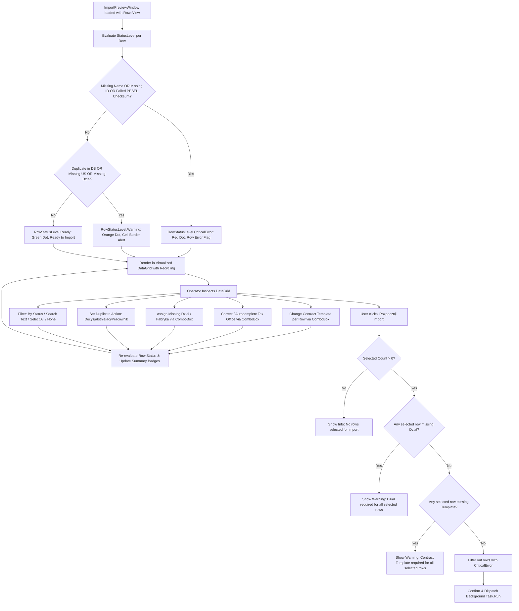
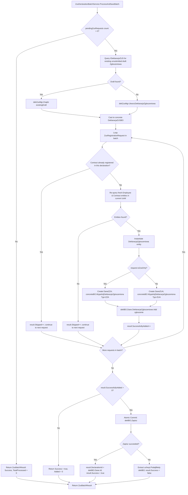

# End-to-End Data Flows & Lifecycle Guide

**Solution**: HrAppka Import Pracowników (v1.0.8.20)  
**Target Environment**: InsERT Gratyfikant Nexo Pro SDK 62.0.0.9537 (.NET 8 Windows)  
**Host Application**: `Gratyfikant nexo.exe`  

---

## Table of Contents
1. [Overview & Architecture of Data Flows](#1-overview--architecture-of-data-flows)
2. [Flow A: Full Import Lifecycle](#2-flow-a-full-import-lifecycle)
   - [2.1 Mermaid Diagram](#21-mermaid-diagram)
   - [2.2 Structured ASCII Flowchart](#22-structured-ascii-flowchart)
   - [2.3 Detailed Step-by-Step Execution Narrative](#23-detailed-step-by-step-execution-narrative)
3. [Flow B: Ingestion & Normalization Pipeline](#3-flow-b-ingestion--normalization-pipeline)
   - [3.1 Mermaid Diagram](#31-mermaid-diagram)
   - [3.2 Structured ASCII Flowchart](#32-structured-ascii-flowchart)
   - [3.3 Detailed Processing Stages](#33-detailed-processing-stages)
4. [Flow C: Validation Gate & Interactive Operator Resolution](#4-flow-c-validation-gate--interactive-operator-resolution)
   - [4.1 Mermaid Diagram](#41-mermaid-diagram)
   - [4.2 Structured ASCII Flowchart](#42-structured-ascii-flowchart)
   - [4.3 Gating Invariants & Conflict Resolution Matrix](#43-gating-invariants--conflict-resolution-matrix)
5. [Flow D: Sfera Contract Creation & BO Context Attachment](#5-flow-d-sfera-contract-creation--bo-context-attachment)
   - [5.1 Mermaid Diagram](#51-mermaid-diagram)
   - [5.2 Structured ASCII Flowchart](#52-structured-ascii-flowchart)
   - [5.3 Contract Lifecycle Narrative & Wage Date Rules](#53-contract-lifecycle-narrative--wage-date-rules)
6. [Flow E: Single-Save ZUS Declaration Batching](#6-flow-e-single-save-zus-declaration-batching)
   - [6.1 Mermaid Diagram](#61-mermaid-diagram)
   - [6.2 Structured ASCII Flowchart](#62-structured-ascii-flowchart)
   - [6.3 Batch Consolidation Narrative & Error Rollback](#63-batch-consolidation-narrative--error-rollback)

---

## 1. Overview & Architecture of Data Flows

The **HrAppka Import Pracowników** solution processes external, semi-structured tabular data through a deterministic pipeline that ensures data sanitization, schema compliance, user oversight, and transactional persistence in **InsERT Gratyfikant Nexo Pro**.

The architecture partitions data transformations into five distinct operational flows:
1. **Flow A (Full Import Lifecycle)**: The top-level orchestration lifecycle from menu click to final summary dialog.
2. **Flow B (Ingestion & Normalization Pipeline)**: The transformation of raw file bytes into normalized, enriched, and validated in-memory models (`PracownikImportRow`).
3. **Flow C (Validation Gate & Interactive Resolution)**: The human-in-the-loop validation, inline editing, and duplicate conflict resolution layer in the WPF preview window.
4. **Flow D (Contract Creation & BO Context Attachment)**: Dynamic instantiation of Gratyfikant Nexo employee contracts with multi-context Entity Framework alignment, Mox entity sponsorship, and student taxation rules.
5. **Flow E (ZUS Declaration Batching)**: Asynchronous single-save aggregation of ZUA and ZZA social/health registration declarations into an unsubmitted Nexo draft.

---

## 2. Flow A: Full Import Lifecycle

### 2.1 Mermaid Diagram

```mermaid
flowchart TD
    Start([User clicks 'Import Pracowników' in Nexo]) --> OpenDlg[OpenFileDialog: Select .xlsx or .csv]
    OpenDlg --> HasFile{File selected?}
    HasFile -- No --> AbortLog[Log warning & abort operation]
    HasFile -- Yes --> Ingest[UniversalFileLoader.LoadFile]
    
    Ingest --> Warmup[SferaDictionaryCache.Initialize: Warmup static dicts & projections]
    Warmup --> PreAnalyze[PreAnalyzeRows: Match PESEL, Passports, Tax Offices, Templates]
    PreAnalyze --> OpenWpf[ModalWindowHostingService: Open ImportPreviewWindow modal]
    
    OpenWpf --> UserAction{User clicks 'Rozpocznij import'?}
    UserAction -- Cancel / Close --> CloseClean[Close window & abort]
    UserAction -- Proceed --> ValidGate{Pass Validation Gates: Templates & Departments assigned?}
    
    ValidGate -- Fail --> ShowGateWarn[Display alert: All selected rows must have template & department]
    ShowGateWarn --> OpenWpf
    
    ValidGate -- Pass --> LaunchTask[Task.Run on Background Thread]
    LaunchTask --> LoopRows[Loop Selected PracownikImportRow]
    
    LoopRows --> CheckCancel{Cancellation requested?}
    CheckCancel -- Yes --> BreakLoop[Halt loop & finalize completed]
    CheckCancel -- No --> ImportRow[ZaimportujRow20: Check Duplicate Decision]
    
    ImportRow --> RowDecision{DecyzjaIstniejacyPracownik == PominWiersz?}
    RowDecision -- Yes --> MarkSkip[Mark row as skipped duplicate]
    RowDecision -- No --> SaveEmployee[Save/Update Employee BO IPodmiot]
    
    SaveEmployee --> SaveSuccess{BO Zapisz succeeded?}
    SaveSuccess -- No --> HandleClash{Bank account collision?}
    HandleClash -- Yes --> ClearBankRetry[Clear Rachunki & Retry Zapisz]
    HandleClash -- No --> LogUowErrors[Extract Rozszerzenia.PodajBledy & Mark Row Error]
    ClearBankRetry --> RetrySuccess{Retry succeeded?}
    RetrySuccess -- Yes --> HasContract
    RetrySuccess -- No --> LogUowErrors
    
    SaveSuccess -- Yes --> HasContract{Row specifies contract?}
    HasContract -- No --> ReportProgress
    HasContract -- Yes --> CreateContract[ContractCreationService.CreateContract]
    
    CreateContract --> ContractSuccess{Contract Zapisz succeeded?}
    ContractSuccess -- No --> LogContractErr[Extract Rozszerzenia.PodajBledy & Record Warning]
    ContractSuccess -- Yes --> QueueZus{RaportZUS == RCA & isZusSubject?}
    QueueZus -- Yes --> AddZusReq[Queue ZusRegistrationRequest into pendingZusRequests]
    QueueZus -- No --> ReportProgress
    AddZusReq --> ReportProgress
    
    LogContractErr --> ReportProgress
    LogUowErrors --> ReportProgress
    MarkSkip --> ReportProgress
    
    ReportProgress[IProgress.Report: Update UI progress bar & row status] --> MoreRows{More selected rows?}
    MoreRows -- Yes --> LoopRows
    MoreRows -- No --> CheckZusBatch{pendingZusRequests > 0?}
    BreakLoop --> CheckZusBatch
    
    CheckZusBatch -- Yes --> RunZusBatch[ZusDeclarationBatchService.ProcessAndSaveBatch]
    CheckZusBatch -- No --> ShowSummary
    RunZusBatch --> ShowSummary[Display PokazPodsumowanieImportu Summary Dialog]
    ShowSummary --> End([End of Operation])
```



### 2.2 Structured ASCII Flowchart

```
+====================================================================================================+
|                                    FLOW A: FULL IMPORT LIFECYCLE                                   |
+====================================================================================================+
  [User Action] Click "Import Pracowników" in Nexo Module
         |
         v
  [File Selection] OpenFileDialog (*.xlsx, *.xls, *.csv, *.txt)
         |
         +--------------------> (Cancelled) ----> [Exit Gracefully]
         | (File Selected)
         v
  [Step 1: Ingestion & Normalization]
         |  UniversalFileLoader.LoadFile()
         |  - Streaming CSV FSM or MiniExcel XLSX
         |  - AddressNormalizer regex splitting & ZusSchemaLimits
         |  - AddressEnrichmentService SQLite auto-completion
         |  - BankClearingResolver IBAN check & sort-code lookup
         |  - ZusCitizenshipManager ISO country & diacritic mapping
         v
  [Step 2: Dictionary Warmup]
         |  SferaDictionaryCache.Instance.Initialize(uchwyt)
         |  - In-memory lookups for Countries, Tax Offices, Departments, Currencies
         |  - Anonymous database projections for PESEL and Passports
         v
  [Step 3: In-Memory Pre-Analysis]
         |  PreAnalyzeRows()
         |  - Detect existing database duplicates
         |  - Set default conflict actions (AktualizujKartotekeIDodajUmowe)
         |  - Map default contract templates
         v
  [Step 4: Interactive WPF Preview]
         |  ModalWindowHostingService.ShowModal(() => new ImportPreviewWindow())
         |  - Operator reviews summary badges, cell alerts, and duplicates
         |  - Operator adjusts contract templates, tax offices, or departments
         |
         +--------------------> (User Clicks Cancel) ----> [Close Window & Abort]
         | (User Clicks "Rozpocznij import")
         v
  [Step 5: Pre-Import Validation Gates]
         |  Gate 1: Minimum 1 row selected?
         |  Gate 2: All selected rows have Dział assigned?
         |  Gate 3: All selected rows have Szablon Umowy assigned?
         |
         +--------------------> (Gate Failed) ---------> [Show Warning Alert & Return to UI]
         | (Gates Passed)
         v
  [Step 6: Asynchronous Batch Worker Execution]
         |  Task.Run(..., CancellationTokenSource.Token)
         |  Loop through selected PracownikImportRow items:
         |  |
         |  +--> Check Cancellation Token Requested? --> Break Loop
         |  |
         |  +--> Check DecyzjaDlaIstniejacego:
         |  |      * PominWiersz -> Skip and log duplicate
         |  |      * TylkoDodajUmowe -> Preserve existing card; proceed to contract
         |  |      * NadpiszUmowe -> Terminate existing active contracts; update card
         |  |      * AktualizujKartotekeIDodajUmowe -> Update card; create parallel contract
         |  |
         |  +--> Save Employee Business Object (IPodmiot)
         |  |      * Success -> Proceed to contract
         |  |      * Bank account clash -> Wipe podmiot.Rachunki and retry Zapisz()
         |  |      * Failure -> Extract Mox errors via Rozszerzenia.PodajBledy and skip contract
         |  |
         |  +--> Create Contract via ContractCreationService
         |  |      * Multi-context Entity Framework alignment
         |  |      * Mox child sponsorship (Stanowiska)
         |  |      * Wage component 1st-of-month alignment
         |  |      * Student under 26 exemption mapping
         |  |
         |  +--> Accumulate ZUS Registration Request (pendingZusRequests)
         |  |
         |  +--> IProgress.Report() -> Dispatch progress update to UI thread
         v
  [Step 7: Post-Import ZUS Batch Processing]
         |  ZusDeclarationBatchService.ProcessAndSaveBatch()
         |  - Locate or create single unsubmitted draft Zgloszeniowa declaration
         |  - Append all DaneZUA and DaneZZA records
         |  - Commit atomic single deklBO.Zapisz()
         v
  [Step 8: Summary Report Dialog]
         |  PokazPodsumowanieImportu()
         |  - Display counts of imported, skipped, errors, and warnings
         v
  [Finish] End of Operation
```

### 2.3 Detailed Step-by-Step Execution Narrative

1. **Trigger**: The user initiates the import by clicking the `"Import Pracowników"` button within the Gratyfikant Nexo "Pracownicy" (Employees) module list.
2. **File Selection**: An `OpenFileDialog` prompts for an Excel (`.xlsx`, `.xls`) or CSV (`.csv`, `.txt`) file. If cancelled, the operation gracefully exits without side effects.
3. **Ingestion & Normalization**: The raw file is streamed into memory. Addresses are normalized via regular expressions, IBANs are verified via Modulo 97, nationalities are mapped to ZUS entries, and identity documents are selected according to citizenship rules.
4. **Dictionary Warmup**: `SferaDictionaryCache` fetches all reference data and executes a database-level projection of all existing employees, eliminating database roundtrips during preview and import.
5. **Pre-Analysis**: Every row is matched against the cache. If a matching PESEL or Passport is found, the row is flagged as `"Istnieje w bazie"` and assigned a default conflict resolution strategy (`AktualizujKartotekeIDodajUmowe`).
6. **WPF Preview Window**: A virtualized modal DataGrid displays the parsed rows. Rows with missing mandatory fields are highlighted in red; warnings (such as unmapped tax offices or duplicates) appear in yellow. The operator can edit fields, change templates, and select rows for import.
7. **Validation Gating**: When `"Rozpocznij import"` is clicked, validation guards verify that every selected row has an assigned organizational department and contract template.
8. **Asynchronous Import**: Work is offloaded to a background thread (`Task.Run`). For each selected employee, an `IPodmiot` Business Object is created or updated, contracts are generated via `ContractCreationService`, and ZUS registration requests are queued.
9. **Single-Save ZUS Batch**: All accumulated ZUS registration requests are added to an unsubmitted draft declaration and committed in a single transaction via `ZusDeclarationBatchService`.
10. **Summary Presentation**: An aggregate report summarizes total processed, successful, skipped, and failed rows.

---

## 3. Flow B: Ingestion & Normalization Pipeline

### 3.1 Mermaid Diagram

```mermaid
flowchart TD
    RawFile[Raw File Path] --> ExtCheck{Check File Extension}
    
    %% CSV Engine
    ExtCheck -- .csv or .txt --> DetectEnc[Rfc4180CsvReader.DetectEncoding]
    DetectEnc --> ProbeBOM{BOM Present?}
    ProbeBOM -- UTF-8 BOM --> UseUtf8Bom[Encoding: UTF-8 BOM]
    ProbeBOM -- UTF-16 / UTF-32 --> UseUtf16[Encoding: UTF-16 / UTF-32]
    ProbeBOM -- None --> SampleBuf[Read 4096-byte sample buffer]
    SampleBuf --> CutBoundary[AdjustLengthForIncompleteTrailingUtf8: Rewind incomplete multibyte header]
    CutBoundary --> TestUtf8{Strict UTF-8 decode succeeds?}
    TestUtf8 -- Yes --> UseUtf8NoBom[Encoding: UTF-8 No BOM]
    TestUtf8 -- No --> UseWin1250[Encoding: Windows-1250 Polish Codepage Provider]
    
    UseUtf8Bom --> DetectDelim[DetectDelimiter: Tally candidates ; , tab |]
    UseUtf16 --> DetectDelim
    UseUtf8NoBom --> DetectDelim
    UseWin1250 --> DetectDelim
    
    DetectDelim --> FsmParse[Streaming FSM: Handle quotes, escaped quotes, multiline CRLF]
    FsmParse --> RawRows[List of String Tuples]
    
    %% XLSX Engine
    ExtCheck -- .xlsx or .xls --> MiniEx[MiniExcel.Query: Streaming XLSX reader]
    MiniEx --> RawRows
    
    %% Schema Detection
    RawRows --> DetectSchema{Header count >= 38 & col 1 is 'Dział'?}
    DetectSchema -- Yes --> MapLegacy[Legacy 38-Col Layout Mapper]
    DetectSchema -- No --> MapStandard[Modern 36-Col Fixed Layout Mapper]
    
    MapLegacy --> BuildRow[Instantiate PracownikImportRow]
    MapStandard --> BuildRow
    
    %% Normalization & Enrichment
    BuildRow --> SplitName[Normalize & Split Names: First, Second, Last Name; Strip diacritics if corrupt]
    SplitName --> PeselRepair[PeselHelper: Repair scientific notation e.g. 8.4E10 -> Validate checksum]
    PeselRepair --> NormAddr[AddressNormalizer: Decompose street, house, apartment via 5 compiled regexes]
    NormAddr --> ZusLimits[ZusSchemaLimits: Truncate Street 30, House 7, City 26, Postcode XX-XXX]
    ZusLimits --> SanitizeNoise[SanitizeAddressFields: Detect phone or name infiltration into street]
    SanitizeNoise --> EnrichSqlite[AddressEnrichmentService: Probing DaneAdresowe.db -> Populate Gmina/Powiat]
    EnrichSqlite --> BankCheck[BankClearingResolver: Extract KNR -> Validate Modulo 97 -> Resolve Bank Name]
    BankCheck --> ZusCit[ZusCitizenshipManager: Match Obywatelstwa_ZUS.csv -> Strict No Silent PL Fallback]
    ZusCit --> DocSelect[DocumentIdentificationService: Polish vs EU vs Non-EU Foreign Priority -> 9-Char Cut]
    
    DocSelect --> ValidatedCollection[(Collection of Validated PracownikImportRow)]
```

### 3.2 Structured ASCII Flowchart

```
+====================================================================================================+
|                              FLOW B: INGESTION & NORMALIZATION PIPELINE                            |
+====================================================================================================+
  [Source File] (*.xlsx, *.xls, *.csv, *.txt)
        |
        v
  [UniversalFileLoader.LoadFile]
        |
        +-- (.xlsx / .xls) ------------> [MiniExcel Streaming Query] --------------------+
        |                                                                                |
        +-- (.csv / .txt) -------------> [Rfc4180CsvReader]                              |
                                         |  1. BOM Probing (UTF-8, UTF-16, UTF-32)       |
                                         |  2. 4096-Byte Sample & Multibyte Boundary Cut |
                                         |  3. Fallback to Windows-1250 Codepage         |
                                         |  4. Delimiter Auto-Detection (;, ,, \t, |)    |
                                         |  5. FSM Parser: Quotes, Multiline CRLF        |
                                         v                                               |
                                         [Raw String Rows / Cells] <---------------------+
                                         |
                                         v
  [Schema Layout Detection]
        |  Check if Header Count >= 38 and Column 1 == "Dział"
        |  - True  -> Legacy 38-Column Mapper
        |  - False -> Standard 36-Column Fixed Layout Mapper
        v
  [PracownikImportRow Instantiation]
        |
        v
  [Address Normalization: AddressNormalizer.Normalize]
        |  1. StreetPrefixRegex: Strip "ul.", "ulica "
        |  2. StreetTrailingNumberRegex: Extract house/apartment if merged into street
        |  3. CompoundHouseAptRegex: Split "12/4", "15B m. 5", "10 lokal 2"
        |  4. NormalizePostalCode: Format as "XX-XXX" for Nexo, 5 digits for ZUS
        |  5. ZusSchemaLimits: Street <= 30, House <= 7, Apt <= 7, City <= 26
        v
  [Address Sanitization: UniversalFileLoader.SanitizeAddressFields]
        |  - Detect and wipe First/Last Name infiltrating Street field
        |  - Detect and wipe Phone Number infiltrating Street field
        v
  [Offline SQLite Enrichment: AddressEnrichmentService.EnrichRowAddress]
        |  - Probe DaneAdresowe.db (AppDomain, Binaries, LocalAppData)
        |  - Query: SELECT Miejscowosc, Gmina, Powiat, Wojewodztwo WHERE Kod = @code
        |  - Thread-safe ConcurrentDictionary caching (Fail-safe on missing DB)
        v
  [Banking & Sorting Code: BankClearingResolver]
        |  - Extract 8-digit KNR sort code from positions 2..9 of NRB
        |  - Dictionary lookup: 38+ national banks + SGB/BPS cooperative branches
        |  - ISO 7064 Modulo 97 IBAN checksum validation
        v
  [Citizenship Resolution: ZusCitizenshipManager]
        |  - Search Obywatelstwa_ZUS.csv (Adjective, Country, ISO, Diacritic-free)
        |  - CRITICAL: Return NULL on unrecognized nationality (Strict NO silent PL fallback)
        v
  [Document Identification: DocumentIdentificationService]
        |  - Polish citizens: Dowód osobisty -> Paszport -> PESEL
        |  - EU residents: Paszport Bio -> Dowód UE with MANDATORY Country of Issue
        |  - Foreign non-EU: Paszport with STRICT MANDATORY Country of Issue
        |  - Sanitize alphanumeric characters, truncate to ZUS max 9 characters
        v
  [Output] Clean, validated, and enriched collection of PracownikImportRow objects
```

### 3.3 Detailed Processing Stages

| Stage | Class / Component | Responsibilities | Output / Guarantee |
|---|---|---|---|
| **1. Ingestion** | `UniversalFileLoader`, `Rfc4180CsvReader` | Format detection, BOM inspection, buffer boundary recovery, multiline cell handling. | Streaming enumeration of raw string rows. |
| **2. Layout Mapping** | `UniversalFileLoader` | Dispatches between legacy 38-column and modern 36-column standard schemas. | Strongly typed `PracownikImportRow` objects. |
| **3. PESEL Repair** | `PeselHelper` | Parses Excel scientific notation floats (e.g. `8.4030421022E10`), restores leading zeros. | Exact 11-digit PESEL, birth date, and gender. |
| **4. Address Parsing** | `AddressNormalizer` | Decomposes compound house/apartment strings using compiled regexes; truncates to ZUS limits. | Normalized street, house, apartment, city, and postal code. |
| **5. Address Enrichment**| `AddressEnrichmentService`| Offline SQLite lookups against `DaneAdresowe.db` via postal code. | Auto-completed Gmina, Powiat, and Województwo. |
| **6. Banking** | `BankClearingResolver` | Extracts 8-digit KNR, derives institutional bank name, validates Modulo 97 IBAN checksum. | Verified bank account number and bank description. |
| **7. Citizenship** | `ZusCitizenshipManager` | Maps adjectives/country names to ISO codes; strictly prohibits defaulting foreigners to Poland. | Verified ZUS country code and citizenship adjective. |
| **8. Documents** | `DocumentIdentificationService`| Applies nationality-based document priority, enforces country of issue, truncates to 9 characters. | Validated identity document type, series/number, and dates. |

---

## 4. Flow C: Validation Gate & Interactive Operator Resolution

### 4.1 Mermaid Diagram



### 4.2 Structured ASCII Flowchart

```
+====================================================================================================+
|                    FLOW C: VALIDATION GATE & INTERACTIVE OPERATOR RESOLUTION                        |
+====================================================================================================+
  [Parsed Rows Loaded into ImportPreviewViewModel]
        |
        v
  [Per-Row Health Evaluation: StatusLevel]
        |
        +-- CriticalError (Red):
        |     * Imie or Nazwisko is empty
        |     * PESEL, Dowód, and Paszport all empty
        |     * PESEL fails Modulo 10 checksum
        |
        +-- Warning (Yellow):
        |     * Duplicate found in Gratyfikant Nexo database (IsDuplicate == true)
        |     * Tax Office unmapped (SelectedOrganPodatkowy == null)
        |     * Missing non-blocking address components
        |
        +-- Ready (Green):
              * All required fields valid and present
        v
  [DataGrid Presentation: VirtualizingStackPanel Recycling]
        |
        +--> Inline Template ComboBox: Override contract template per employee
        +--> Inline Tax Office ComboBox: Searchable auto-complete with warning alerts
        +--> Inline Duplicate Resolution ComboBox (DecyzjaIstniejacyPracownik):
        |      * AktualizujKartotekeIDodajUmowe (Default for duplicates)
        |      * TylkoDodajUmowe (Keep existing card intact)
        |      * NadpiszUmowe (Terminate prior active contracts with dtStart - 1)
        |      * PominWiersz (Skip row entirely)
        +--> Inline Dział ComboBox: Required organizational department assignment
        +--> Global Filter Toolbar: Filter by Status Level, Free-text search, Batch select
        v
  [User Action: Click "Rozpocznij import"]
        |
        v
  [Validation Gating Rules]
        |
        |--- Gate 1: Selected Count > 0?
        |      [No] -> Show Info Alert: "Proszę zaznaczyć co najmniej jednego pracownika."
        |
        |--- Gate 2: Any selected row missing Dział?
        |      [Yes] -> Show Warning Alert: "Wszyscy zaznaczeni pracownicy muszą mieć przypisany Dział."
        |
        |--- Gate 3: Any selected row missing Szablon Umowy?
        |      [Yes] -> Show Warning Alert: "Wszyscy zaznaczeni pracownicy muszą mieć wybrany Szablon umowy."
        |
        v (All Gates Passed)
  [Execution Confirmation]
        |  Exclude CriticalError rows from import batch
        |  Display confirmation dialog if duplicate overrides or warnings exist
        v
  [Offload to Background Thread] Launch Task.Run with CancellationTokenSource
```

### 4.3 Gating Invariants & Conflict Resolution Matrix

| Decision Enum (`DecyzjaIstniejacyPracownik`) | Card Data Updates | Address & Bank Updates | Existing Active Contracts | New Contract Created | ZUS RCA / ZUA Queued |
|---|---|---|---|---|---|
| **`PominWiersz`** | None | None | Intact | Skipped | Skipped |
| **`TylkoDodajUmowe`** | None (Preserved) | None (Preserved) | Intact | Created (if dates differ) | Queued if RCA |
| **`NadpiszUmowe`** | Overwritten | Overwritten | **Terminated** (`dtStart - 1`)| Created | Queued if RCA |
| **`AktualizujKartotekeIDodajUmowe`** | Overwritten | Overwritten | Intact (Parallel contract)| Created (if dates differ) | Queued if RCA |

---

## 5. Flow D: Sfera Contract Creation & BO Context Attachment

### 5.1 Mermaid Diagram

```mermaid
flowchart TD
    CallCreate[ContractCreationService.CreateContract] --> GetTemplate[Retrieve Template Entity via ISzablonyUmowPracowniczych]
    GetTemplate --> ValidateDates[Validate & Parse dtStart, dtEnd, dtSign]
    ValidateDates --> BoInstantiate[Instantiate Contract BO: umowyMgr.Utworz templateEntity]
    
    BoInstantiate --> DiscoverContext[Progressive Context Discovery: Resolve internal ModelDanychContainer]
    DiscoverContext --> HasContext{Context discovered?}
    
    HasContext -- Yes --> RequeryEntities[Re-query Pracownik, Kalendarz, Stanowisko from contract's context]
    HasContext -- No --> OuterAttach[Fall back to outer entities with defensive tracking]
    
    RequeryEntities --> SetDates[Set OkresObowiazywania & DataSporzadzenia]
    OuterAttach --> SetDates
    
    SetDates --> CheckCalendar{Template requires Calendar?}
    CheckCalendar -- Yes --> AssignCalendar[Assign 'Bez cyklu' Calendar & WymiarZatrudnienia = 1/1]
    CheckCalendar -- No --> ClearCalendar[Clear u.Kalendarze for civil contract]
    
    AssignCalendar --> MoxSponsor[Mox Sponsorship: u.Stanowiska.Add st BEFORE st.JednostkaOrganizacyjna]
    ClearCalendar --> MoxSponsor
    
    MoxSponsor --> CheckStudent{Is Student under 26 years old?}
    CheckStudent -- Yes --> ApplyStudentTax[Set RaportZUS = Brak; Suppress social/health contributions; Flaga = NIEOPODATKOWANE]
    CheckStudent -- No --> ApplyNormalTax[Set RaportZUS = RCA; Enable social/health contributions; Flaga = OPODATKOWANE]
    
    ApplyStudentTax --> SetPit[Configure PIT Parameters: ProcentKoszty = 20%, UlgaPodatkowa = false]
    ApplyNormalTax --> SetPit
    
    SetPit --> AlignWage[Wage Component Rule: Set OkresObowiazywania.DataPoczatkowa to 1st of Month]
    AlignWage --> SetCodes[Assign KodZawodu & KodTytuluUbezpieczenia]
    
    SetCodes --> SaveBO[umowaBO.Zapisz]
    SaveBO --> CheckSave{Save succeeded?}
    CheckSave -- Yes --> ReturnContract[Return saved UmowaPracowniczaGr]
    CheckSave -- No --> ExtractErrors[Extract Rozszerzenia.PodajBledy & Throw InvalidOperationException]
```



### 5.2 Structured ASCII Flowchart

```
+====================================================================================================+
|                      FLOW D: SFERA CONTRACT CREATION & BO CONTEXT ATTACHMENT                       |
+====================================================================================================+
  [ContractCreationService.CreateContract(uchwyt, employeePodmiot, row, templateId, dept, wageRate)]
        |
        v
  [Step 1: Resolve Template Entity]
        |  Query ISzablonyUmowPracowniczychGr for template matching templateId
        v
  [Step 2: Instantiate Contract Business Object]
        |  umowyMgr = uchwyt.UmowyPracowniczeGr();
        |  using (IUmowaPracownicza umowaBO = umowyMgr.Utworz(templateEntity))
        v
  [Step 3: Multi-Context Entity Framework Resolution]
        |  Extract internal ModelDanychContainer from umowaBO (Reflection / IGetUnitOfWork)
        |  Re-query employee entity:
        |    u.Pracownik = context.Pracownicy.FirstOrDefault(p => p.Id == empId) ?? outerEmp;
        v
  [Step 4: Contract Dates & Working Time Calendar]
        |  u.OkresObowiazywania.DataPoczatkowa = dtStart;
        |  u.OkresObowiazywania.DataKoncowa = dtEnd; (null if open-ended)
        |  u.DataSporzadzenia = dtSign;
        |  - If template has Kalendarz: assign "Bez cyklu" with WymiarZatrudnienia = 1/1
        |  - If civil zlecenie without calendar: u.Kalendarze.Clear()
        v
  [Step 5: Mox Child Entity Sponsorship (Stanowiska)]
        |  var st = new StanowiskoWUmowiePracowniczej { DataOd = dtStart, LP = 1 };
        |  u.Stanowiska.Add(st); // MUST BE ATTACHED BEFORE SETTING NAVIGATION PROPERTIES!
        |  st.JednostkaOrganizacyjna = attachedDept;
        v
  [Step 6: Student Under 26 Rules (PIT & ZUS Exemption)]
        |  Calculate exact chronological age from birth date and dtStart:
        |  bool isStudentUnder26 = (row.JestStudentem == "Tak") && (age < 26);
        |  - If True:
        |      u.RaportZUS = (byte)TypRaportuZUS.Brak;
        |      u.NaliczaSkladkiEmerytalne = false; ... SkladkiZdrowotne = false;
        |      u.FlagaWlasna = "NIEOPODATKOWANE";
        |  - If False:
        |      u.RaportZUS = (byte)TypRaportuZUS.RCA;
        |      u.NaliczaSkladkiEmerytalne = true; ... SkladkiZdrowotne = true;
        |      u.FlagaWlasna = "OPODATKOWANE";
        v
  [Step 7: Wage Component 1st-of-Month Alignment Rule]
        |  componentStart = new DateTime(dtStart.Year, dtStart.Month, 1);
        |  foreach (var sp in u.SkladnikiPlacowe)
        |      foreach (var val in sp.Wartosci)
        |          val.OkresObowiazywania.DataPoczatkowa = componentStart; // Gratyfikant Constraint!
        v
  [Step 8: Save & Validation Handling]
        |  if (!umowaBO.Zapisz())
        |      throw new InvalidOperationException(uchwyt.PodajBledy(umowaBO));
        v
  [Return] Persisted UmowaPracowniczaGr entity
```

### 5.3 Contract Lifecycle Narrative & Wage Date Rules

1. **Template Selection**: Contracts are created using templates defined in Gratyfikant Nexo (`ISzablonUmowyPracowniczej`). This ensures that default payment terms, overtime rates, and account codes configured by the payroll department are inherited.
2. **Context Discovery & Re-querying**: Sfera Business Objects run inside independent EF ObjectContexts. `ContractCreationService` extracts the BO's `ModelDanychContainer` and re-queries `Pracownik`, `Stanowisko`, and `JednostkaOrganizacyjna` within that context to prevent cross-context tracking collisions.
3. **Mox Sponsorship**: Modifying foreign keys on a child entity before adding it to its parent collection triggers an `UnsponsoredModificationException`. The service adds `StanowiskoWUmowiePracowniczej` to `u.Stanowiska` prior to assigning `JednostkaOrganizacyjna`.
4. **Student Under 26 Exemption**: If an employee is verified as a student under 26 on the contract start date:
   - `u.RaportZUS` is set to `TypRaportuZUS.Brak`.
   - All social, health, accident, FP, and FGŚP contribution flags are set to `false`.
   - The contract's custom flag (`FlagaWlasna`) is tagged as `"NIEOPODATKOWANE"`.
   - For all other workers, contributions are enabled, `RaportZUS` is set to `RCA`, and the flag is tagged as `"OPODATKOWANE"`.
5. **1st-of-Month Wage Start Date**: Gratyfikant Nexo requires that salary component validity periods start on the **1st day of the calendar month**, regardless of mid-month contract start dates (e.g. a contract starting on April 15th must have wage component validity beginning April 1st).

---

## 6. Flow E: Single-Save ZUS Declaration Batching

### 6.1 Mermaid Diagram



### 6.2 Structured ASCII Flowchart

```
+====================================================================================================+
|                        FLOW E: SINGLE-SAVE ZUS DECLARATION BATCHING                                |
+====================================================================================================+
  [pendingZusRequests Collection Accumulated During Step 5]
        |
        v
  [ZusDeclarationBatchService.ProcessAndSaveBatch(uchwyt, pendingZusRequests)]
        |
        +-- (Requests Empty) -> Return Success (TotalProcessed = 0)
        |
        v (Requests Exist)
  [Search for Existing Unsubmitted Draft Declaration]
        |  Query dekZusMgr.Dane.Wszystkie():
        |    RodzajDeklaracji == Zgloszeniowa AND
        |    StatusWysylki == Brak AND
        |    WyslanyDoPlatnika == False
        |
        +-- Found Draft ------> [dekZusMgr.Znajdz(existingDecl)] ----+
        |                                                            |
        +-- No Draft Found ---> [dekZusMgr.UtworzDeklaracjeZgloszeniowa()]
        |                                                            |
        +------------------------------------------------------------+
        v
  [Cast to Concrete Type: DeklaracjaZUSBO]
        |
        v
  [Batch Loop through ZusRegistrationRequest]
        |
        |--- 1. Deduplication Guard:
        |      Check if deklBO.Dane.DeklaracjeZgloszeniowe already contains Contract.Id
        |      If match: increment result.Skipped and continue
        |
        |--- 2. Current Unit of Work Entity Re-query:
        |      Re-fetch fresh employee and contract entities bound to current UoW
        |
        |--- 3. Instantiate DeklaracjaZgloszeniowa Entity:
        |      Link fresh Contract, Employee, and uppercase ImieNazwisko
        |
        |--- 4. Populate ZUA or ZZA Specifics:
        |      * If IsZzaOnly:
        |          Create DaneZZA, call concreteBO.WypelnijDeklaracjeZgloszeniona(z, daneZza)
        |      * Else (Full ZUA):
        |          Create DaneZUA, set contribution flags,
        |          call concreteBO.WypelnijDeklaracjeZgloszeniona(z, daneZua)
        |
        |--- 5. Add to Declaration:
        |      deklBO.Dane.DeklaracjeZgloszeniowe.Add(zgloszenie)
        |      Increment result.SuccessfullyAdded
        v
  [End of Request Loop]
        |
        v
  [Single Atomic Database Save: deklBO.Zapisz()]
        |
        +-- [Success == True]  -> Set result.DeclarationId = deklBO.Dane.Id
        |                         Return Success Result
        |
        +-- [Success == False] -> Extract Mox errors via uchwyt.PodajBledy(deklBO)
                                  Log errors and return Failure Result
```

### 6.3 Batch Consolidation Narrative & Error Rollback

1. **The Problem with Per-Row Saving**: In legacy v1 implementations, each imported worker immediately opened and saved a ZUS declaration. For 200 workers, this triggered 200 separate write transactions against the `DeklaracjeZgloszeniowe` table, resulting in SQL Server lock escalation, transaction timeouts, and fragmented single-item declaration packages.
2. **Draft Reuse**: `ZusDeclarationBatchService` inspects the target database for an existing unsubmitted registration draft (`RodzajDeklaracji.Zgloszeniowa`, `StatusWysylki.Brak`, `!WyslanyDoPlatnika`). If one exists, the service appends new workers to that draft; otherwise, it creates a new draft.
3. **Deduplication Check**: Before appending a registration, the service verifies that the contract is not already included in the declaration, preventing accidental duplicates if import is re-run.
4. **Concrete Sfera Helper Invocation**: Populating ZUS declarations requires invoking internal calculation logic on `DeklaracjaZUSBO.WypelnijDeklaracjeZgloszeniona()`, mapping proper ZUS registration types (`TypDeklaracjiZgloszeniowej.ZUA` vs `TypDeklaracjiZgloszeniowej.ZZA`).
5. **Atomic Commit**: All registrations are committed to SQL Server in a single `deklBO.Zapisz()` call. If validation fails, all additions are rolled back together, ensuring the draft declaration remains internally consistent.
